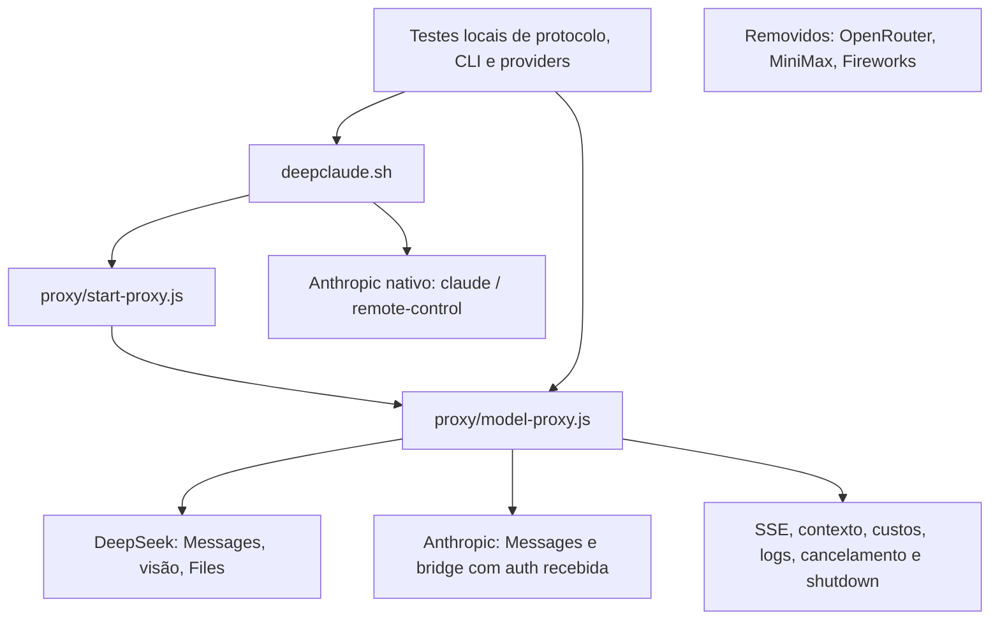

# Remoção de providers: DeepSeek e Anthropic

Escopo autorizado: remover OpenRouter, MiniMax e Fireworks e manter DeepSeek e
Anthropic, com regressões locais. Branch `refactor/deepseek-anthropic-only`,
base `824fa8b`. Worktree inicialmente limpo. Relatório da validação local anterior
à publicação das alterações.

## Discovery e classificação

Stack: Bash/Linux e Node ESM com HTTP/streams nativos, sem framework, compilação
ou dependências externas de runtime. Ferramentas locais existentes foram
reutilizadas: ast-grep, Knip, Semgrep, dependency-cruiser, jscodeshift e Stryker.
Nenhum pacote ou servidor MCP novo foi instalado. Não havia índice CodeGraph.

| Unidade | Consumidores/configuração | Classificação e destino |
| --- | --- | --- |
| Backends OpenRouter/MiniMax/Fireworks | CLI, env, registry, remap e custos | Exclusivos: removidos |
| Aliases or/op/mm/fw | Launcher, inicialização e switch | Removidos; seletores agora falham explicitamente |
| Override genérico de modelo | --model do launcher, quinto argumento, CHEAPCLAUDE_MODEL e estado modelOverride | Exclusivo da rota OpenRouter: removido |
| Autenticação inferida pelo hostname/useBearer | Rotas dos providers removidos | Removida; DeepSeek usa x-api-key |
| Filtro de redacted_thinking fora de ordem | Respostas de modelos do OpenRouter | Removido; blocos válidos preservados em JSON e SSE |
| Remoção de thinking para outros backends | prepareBackendOptions | Ramo exclusivo removido; normalização DeepSeek preservada |
| HTTP/SSE, autenticação Anthropic, bridge, visão, Files | Fluxos sobreviventes | Compartilhados: mantidos |
| Análise estática, locks e ferramentas de desenvolvimento | Skill e CI | Mantidos; não são SDKs de providers |

Nenhum módulo inteiro ou pacote de runtime precisava ser removido: os adapters
eram registros e ramos nos três arquivos principais. Não foram alterados segredos
privados do shell, diretórios de sessões nem configurações globais. Nomes antigos
permanecem somente em testes negativos, guardas, exemplos de policy e histórico.

## Grafo afetado

O grafo de módulos por AST está em
`.surgical-refactor/artifacts/verify/graph.mmd`, com inventário e saída do
dependency-cruiser no mesmo diretório. Ele não representa um call graph completo
de Bash/configuração; a matriz acima registra a revisão desses vínculos.

## Contratos e correções

- CLI aceita ds/deepseek ou anthropic. Providers removidos falham antes de
  lançar processos/chamar rede, inclusive pelo backend padrão do ambiente.
- Inicialização do proxy rejeita modos e registros desconhecidos. Switch inválido
  não altera estado; o valor completo do formulário é validado, sem aceitar
  prefixos como `deepseek-extra`.
- DeepSeek preserva modelo Flash, visão, histórico de reasoning, esforço,
  ferramentas nativas, Files, cache, compactação em 786432, logs e streaming.
- Credenciais DeepSeek substituem a auth apenas nas rotas DeepSeek. Anthropic e
  bridge preservam credenciais recebidas. O switch não converte uma chave DeepSeek
  em uma credencial Anthropic.
- O launcher Anthropic retorna ao encerrar o filho; foi corrigido o fallthrough
  que tentava iniciar proxy depois disso, em modo normal e remoto.
- Flags standalone --mode/--port deixaram de ser confundidas com URL/chave
  posicionais. O modo posicional mantém stdout contendo somente a porta.
- --model após -- é passthrough nativo do Claude Code. Não existe mais override
  genérico de provider/modelo no proxy.
- A guarda anterior contra suporte Windows continua ativa.

## Testes antes e depois

Baseline desta tarefa preservado em
`.surgical-refactor/artifacts/before-remove-providers/verification.json`.
O baseline versionado da skill não foi sobrescrito.

| Verificação | Antes | Depois |
| --- | --- | --- |
| Regressões Node do proxy/launcher | 56 aprovadas | 67 aprovadas |
| Testes da skill | 13 aprovados | 13 aprovados |
| Total | 69 aprovados | 80 aprovados |
| Falhas preexistentes observadas | Nenhuma | Nenhuma falha final |
| Sintaxe Node e Bash | Aprovada | Aprovada |
| Knip, dependency-cruiser, ast-grep, Semgrep | Sem findings | Sem novos findings ou erros de ferramenta |
| Policy/contratos/entry points | Aprovados | Aprovados, com proibições dos providers |
| model-proxy.js: linhas | 86,79% | 92,53% |
| model-proxy.js: branches | 84,57% | 86,28% |
| model-proxy.js: funções | 82,56% | 89,89% |

As duas regressões específicas dos providers aposentados foram substituídas por
contratos de remapeamento DeepSeek explícito e por tier futuro; seus comportamentos
originais foram removidos intencionalmente. Foram retiradas as asserções exclusivas
do override e da supressão de thinking estrangeiro, preservando as de DeepSeek.
Não houve redução de asserções sobre comportamentos mantidos para esconder falhas.

A nova suíte `proxy/provider-contract.test.js` testa rejeições, inicialização com
e sem chave, aliases, switch sem mutação de estado, autenticação, bridge, reasoning,
redacted thinking JSON/SSE, CLI normal/remoto, passthrough, env e wrapper do proxy.
Todos os upstreams são locais/simulados; launchers usam executáveis de teste.

Cobertura nativa de start-proxy.js é parcial: 74,14% das linhas, 9,09% das branches.
O contrato posicional/env também é exercitado numa cópia temporária do wrapper
com startModelProxy simulado; essa cobertura não é somada ao arquivo de produção.
Bash tem testes de contrato, sem medição de cobertura de branches.

## Mutation testing

O perfil foi ampliado de construção de URLs para incluir os guardas de modo,
registry e chave inicial. Gate permanece em 90%.

A primeira execução ampliada ficou em **89,83%** e bloqueou corretamente a entrega.
Revelou lacunas de caracterização do alias inicial ds e dos casos de chave ausente.
Foram acrescentados testes diretos, incluindo cleanup dos servidores caso um
mutante aceite uma configuração proibida; isso evita contabilizar sockets vazados
como timeouts de teste.

Resultado final: **98,31%**, 59 mutantes:

| Trecho | Killed | Timeout | Survived |
| --- | --- | --- | --- |
| buildUpstreamPath | 29 | 2 | 1 |
| Guardas iniciais de providers | 27 | 0 | 0 |
| Total | 56 | 2 | 1 |

Os dois timeouts alteram o loop de path para laços sem fim. O sobrevivente troca
Math.min por Math.max no limite de sobreposição: possivelmente equivalente para
o path retornado, mas com iterações adicionais. Não foi excluído para aumentar
o score. Não houve erros ou NoCoverage. O score não cobre todo o proxy nem Bash.
Artefato: `.surgical-refactor/artifacts/mutation/mutation.json`.

## Guardas de CI e arquivos

O workflow existente executa verify e o gate de mutação ampliado. A policy em
`.surgical-refactor/config.json` proíbe referências aos providers, credenciais e
override removidos nos entry points reais. Testes negativos ficam fora dessa
proibição textual; não são implementação de provider. O CI também compara findings
com o baseline e mantém os testes Windows. Os resultados acima são locais;
a execução hospedada é acionada pela publicação na main ou por pull request.

Arquivos de produção: `deepclaude.sh`, `proxy/start-proxy.js`, `proxy/model-proxy.js`.
Testes: `proxy/provider-contract.test.js` novo e ajustes em `model-proxy.test.js`,
`deepseek-compat.test.js`, `platform-contract.test.js`, `upstream-path.test.js`.
Guardas: `.surgical-refactor/config.json`, `.surgical-refactor/contracts.md`,
`.agents/skills/surgical-refactor/config/stryker.config.mjs` e SKILL.md.
Documentação: README.md, CLAUDE.md, AGENTS.md, proxy/README.md,
docs/surgical-refactor.md, docs/dead-code-audit.md e este relatório.

## Limitações e ativação

Não foram executadas chamadas reais/faturáveis, sessões interativas reais, E2E
estabelecido, build ou typecheck (os três últimos não existem nesta stack).
Disponibilidade dos serviços, autenticação real e limites de terceiros precisam
de validação de uso. Testes e análise estática não provam equivalência semântica.

Após autorização para encerrar restos de proxy, a inspeção não encontrou nenhum
processo start-proxy.js deste repositório. O próximo `deepclaude` carrega a versão
nova. Não foi iniciada uma sessão do usuário automaticamente.
